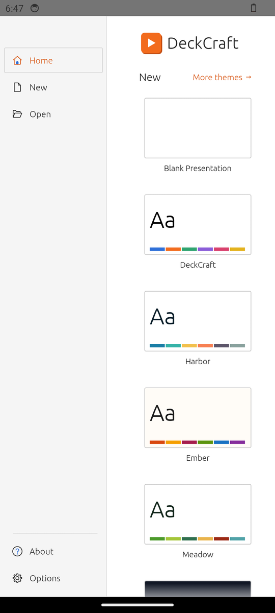
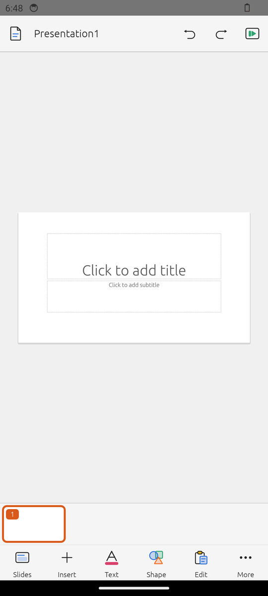
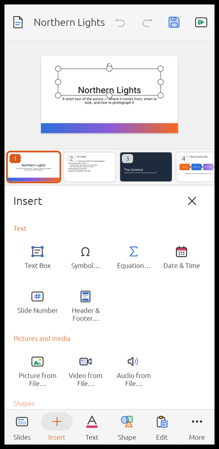
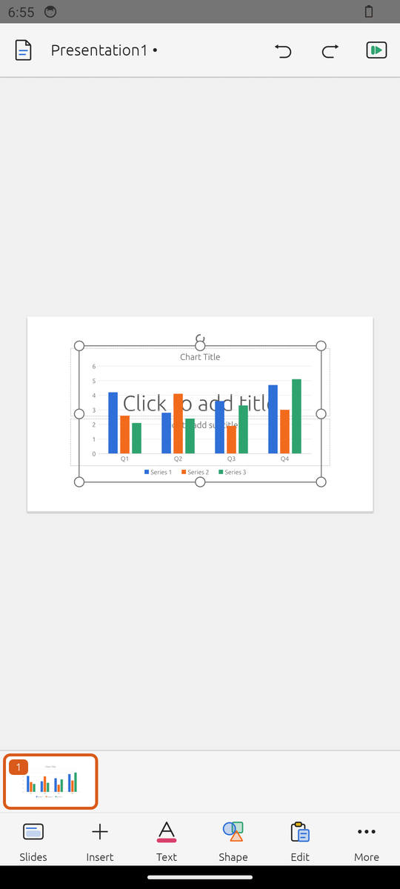
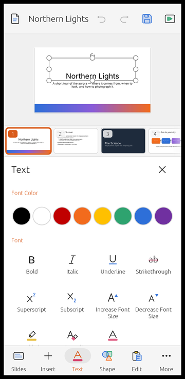
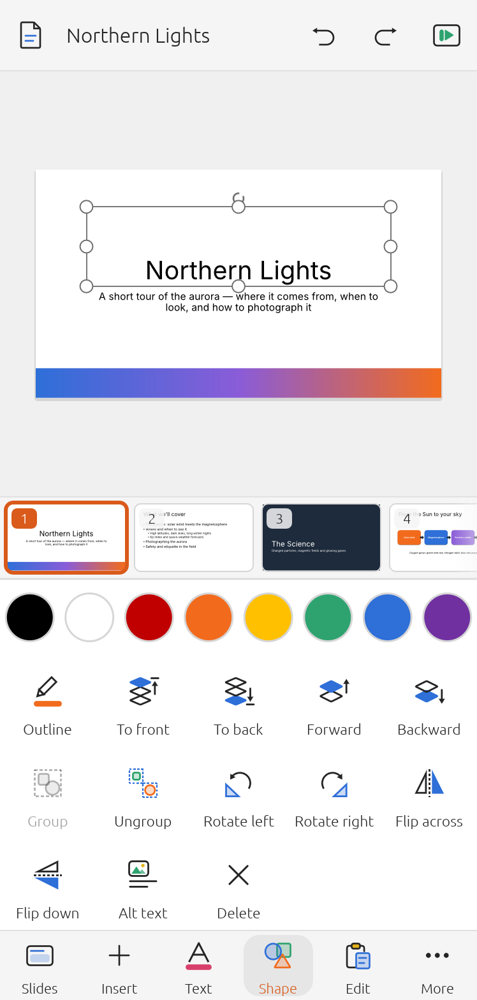
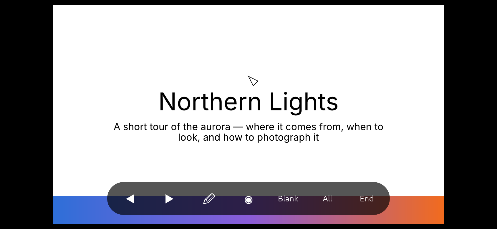

# Custom DeckCraft for Android

> [!WARNING]
> **This project is made entirely by AI.** All of the code, notes and documentation in this
> repository's Android work were written by AI coding agents (Anthropic's Claude models), directed
> by a person who did not write or review the code line by line. It has not had human code
> review or security review, and it has only been tried briefly on an Android emulator, never on a
> physical phone. Expect bugs. Do not trust it with presentations you can't afford to lose.

> [!IMPORTANT]
> **This is an unofficial, personal fork. It is not made, endorsed or supported by the ArtCraft
> team or by storytold.** It is not the official DeckCraft, and it is not an ArtCraft project.
> Please don't report problems with this fork to the original project.

## Screenshots

<p>   </p>

<p>  </p>

The first four pictures are screenshots from an Android 14 emulator. The Text sheet, the Shape sheet
and the slide show are drawn by the app's own UI test renderer at phone size, because the emulator
(software-emulated, with no hardware acceleration) was too slow to drive them reliably.

## What this is

**In short: a phone interface for Android on top of the DeckCraft presentation engine.**
[DeckCraft](https://github.com/storytold/deckcraft) is an open-source Rust presentation app by the
ArtCraft team. Everything that makes it a presentation app (the slide model, text layout, shapes,
animations, `.pptx` and other file formats, rendering) is the original DeckCraft engine. This fork
adds a touch layout around it and the Android plumbing to host it as a **native app** (no
WebView): a GameActivity with Kotlin bridges for the keyboard, the system file picker and the
clipboard.

It is a sister project of
[Custom WordCraft for Android](https://github.com/Murdock011/custom-wordcraft-android) and
[Custom GridCraft for Android](https://github.com/Murdock011/custom-gridcraft-android), built the
same way. Changes below the interface are listed in
[docs/ENGINE-CHANGES.md](docs/ENGINE-CHANGES.md). It is currently based on DeckCraft engine
**0.18.1**.

## Download

Builds are on the [Releases page](https://github.com/Murdock011/custom-deckcraft-android/releases).
The latest is **0.1.0**: `custom-deckcraft-android-arm64.apk`, for 64-bit ARM phones (arm64-v8a)
with Android 10 or newer. It is signed with a debug key, so Android asks you to allow installs from
your browser or file manager. It installs as `ai.storyteller.deckcraft.native`, next to any other
DeckCraft, WordCraft or GridCraft build.

## What is built

- A native Android host: the DeckCraft interface runs in an eframe window on `android-activity`.
- A phone layout for windows narrower than 600 pt: an app bar (File, the presentation name,
  Undo, Redo, Play from start), a row of slide chips, and a bottom tab bar (Slides, Insert, Text,
  Shape, Edit, More). A tab opens a sheet of large labelled tiles above the bar, so the slide stays
  in view and editable: slide layouts and order, shapes, tables, charts and media, text formatting
  with colour swatches, arrange and alignment, cut, copy and paste, view, panes and Play. Every
  tile runs the same command as the desktop ribbon. More ▸ All tools opens every ribbon tab and command of the
  engine (about 290), with pickers for themes, transitions, animations, shapes and the like, forms for typed values,
  and a search. In a slide show, tap goes forward, swipe left
  or right turns the page, a bar of 48 pt buttons (Back, Next, Pen, Laser, Blank, All, End) shows
  after a touch, and Back ends the show.
- Opening presentations through the system file picker (.pptx, .ppsx, .potx, .deckcraft), and
  saving through the system save dialog. Plain Save writes back to the document that was opened,
  and the unsaved dot clears only after the system reports the save worked.
- Unsaved work is written to AutoRecover when the app is paused, and reopened on the next start.
- A hardware keyboard's Ctrl+V pastes the Android clipboard's text.

These parts are covered by host tests or desktop UI tests. None has run on an Android device or
emulator.

## Known gaps

- Built as an arm64 debug APK and tried briefly on an emulator, but not on a physical phone. Expect bugs.
- The soft keyboard bridge is new and has only been tested on the desktop. Suggestions are still
  turned off until typing is confirmed on a device.
- Pinch zoom, pen and laser by touch have only been tried in desktop tests.

Work in progress is logged step by step in [notes/native-port.md](notes/native-port.md).

## What this fork adds

- `apps/deckcraft-android/`: the native Android host (Rust).
- `packaging/android-native/`: the Gradle project, `build-native.sh` and the app icon.
- `crates/ui-egui/src/phone.rs`, `phone_sheet.rs` and small hooks in `crates/ui-egui/src/app.rs`: the phone layout.
  They only apply on narrow screens; the desktop layout is unchanged.
- `vendor/egui`, `vendor/egui-winit`: egui 0.37 with the Android keyboard patches the sibling forks
  use (see each `LICENSE-NOTE.md`).
- `notes/native-port.md`: what was done, update by update.

## Building

Needs the Android SDK and NDK 27, `cargo-ndk`, and the Rust Android targets.

```sh
rustup target add aarch64-linux-android x86_64-linux-android
cargo install cargo-ndk
sh packaging/android-native/build-native.sh x86_64         # emulator
sh packaging/android-native/build-native.sh arm64-v8a      # phone
```

The debug APK is written to `packaging/android-native/app/build/outputs/apk/debug/`. This build
has not been run yet.

## Updating the engine

The fork keeps the original project's full history, so a newer DeckCraft version comes in with an
ordinary `git merge` of its release tag. Conflicts can only be in the files this fork changed
(see above and [docs/ENGINE-CHANGES.md](docs/ENGINE-CHANGES.md)); keep upstream's change and
re-apply this fork's on top.

## Credit and licence

All of DeckCraft itself, the presentation engine, file formats and desktop interface, is the work
of the ArtCraft team and the DeckCraft contributors. This fork keeps their licence:
MIT OR Apache-2.0, at your option ([LICENSE-MIT](LICENSE-MIT), [LICENSE-APACHE](LICENSE-APACHE)).
Asset credits are in [ATTRIBUTION.md](ATTRIBUTION.md). The original project's README is kept in
[docs/UPSTREAM-README.md](docs/UPSTREAM-README.md).

Names, logos and branding of DeckCraft and ArtCraft belong to their owners; their use here only
identifies where the code came from.
